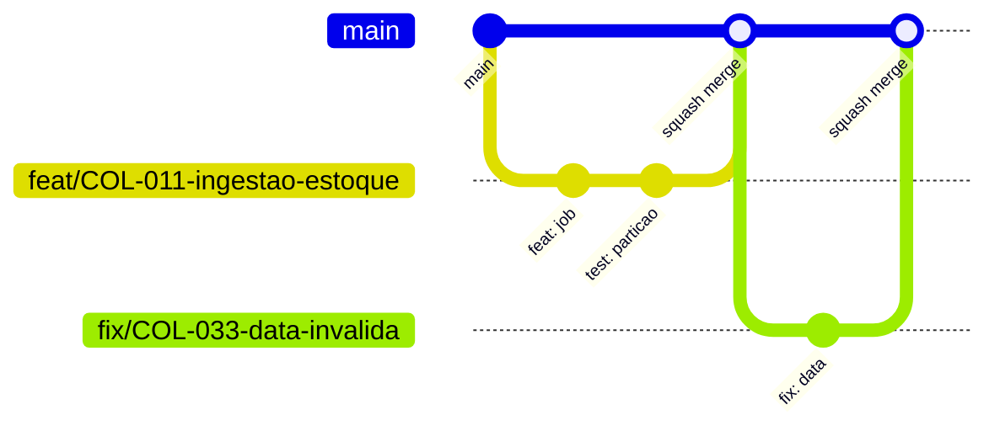

# Como contribuir

Este guia descreve como o trabalho anda no repositório `colheita`: do card no board até o merge na `main`.

## Resumo em 7 passos

1. Pegue um card no board e mova para **Em andamento**.
2. Atualize a `main` local.
3. Crie uma branch curta: `tipo/COL-000-descricao`.
4. Faça commits pequenos no padrão Conventional Commits.
5. Teste em **dev**.
6. Abra o PR, preencha o template e mova o card para **Em revisão**.
7. Depois da aprovação e do check verde, faça **squash merge** e apague a branch.

## Fluxo de branches

Usamos **trunk-based development** com branches curtas:

- A `main` é a única branch permanente e está sempre pronta para deploy.
- Ninguém faz push direto na `main`: toda mudança entra por pull request (PR).
- Cada branch nasce da `main`, resolve **um** card e vive no máximo **2 ou 3 dias**. Branch que dura muito acumula conflitos.
- Se o card for grande demais para isso, quebre em cards menores.



### Passo a passo no terminal

```bash
# 1. Voltar para a main e trazer o que há de novo no GitHub
git switch main
git pull --ff-only

# 2. Criar a branch do card
git switch -c feat/COL-011-ingestao-estoque

# 3. Trabalhar e commitar (veja o padrão de mensagens abaixo)
git add ingestao/
git commit -m "feat(ingestao): carregar estoque diario na raw_estoque"

# 4. Enviar a branch para o GitHub
git push -u origin feat/COL-011-ingestao-estoque

# 5. Abrir o PR (o template abre no editor)
gh pr create --base main
```

### Se a `main` andou enquanto você trabalhava

Traga as mudanças da `main` para a sua branch com **rebase** (reaplica seus commits por cima da `main` atual):

```bash
git fetch origin
git rebase origin/main
# resolva conflitos, se houver, e então:
git push --force-with-lease
```

`--force-with-lease` só sobrescreve a branch remota se ninguém tiver mexido nela desde o seu último `fetch`. **Nunca** use force push na `main` (o ruleset bloqueia).

## Padrão de nomes de branch

```text
tipo/COL-000-descricao
```

| Parte | Regra |
|---|---|
| `tipo` | Um dos tipos da tabela abaixo |
| `COL-000` | Número do card, com três dígitos |
| `descricao` | 2 a 5 palavras em português, sem acento, separadas por hífen, minúsculas |

| Tipo | Quando usar | Exemplo |
|---|---|---|
| `feat` | Funcionalidade nova | `feat/COL-011-ingestao-estoque` |
| `fix` | Correção de bug | `fix/COL-033-data-invalida-vendas` |
| `docs` | Só documentação | `docs/COL-031-runbook` |
| `chore` | Manutenção sem mudança de comportamento | `chore/COL-005-gitignore-templates` |
| `refactor` | Reorganizar código sem mudar o resultado | `refactor/COL-012-reaproveitar-carga` |
| `test` | Só testes | `test/COL-023-assertions-fatos` |
| `ci` | Pipelines do Cloud Build | `ci/COL-009-gatilho-pr` |
| `infra` | Terraform | `infra/COL-008-recursos-base` |
| `spike` | Investigação com tempo limitado | `spike/COL-015-cdc-datastream` |

> Nos nomes de branch usamos hífen (padrão do Git). Em recursos e código seguimos `snake_case`.
>
> `infra` e `spike` existem só no nome da branch. Nos commits, use `feat(terraform)`, `fix(terraform)` ou `docs(adr)`, porque o Conventional Commits não tem esses dois tipos.

## Padrão de commits: Conventional Commits

Toda mensagem de commit segue o formato:

```text
tipo(escopo opcional): descricao curta no imperativo

corpo opcional explicando o porquê

rodape opcional
```

Regras:

- **descricao**: em português, minúsculas, sem ponto final, até ~72 caracteres, no imperativo ("adicionar", "corrigir", não "adicionado" ou "corrigindo").
- **escopo**: a pasta ou área afetada: `terraform`, `ingestao`, `dataform`, `airflow`, `cloudbuild`, `docs`, `scripts`.
- **corpo**: explica o **porquê**, não o "como" (o diff já mostra o como).
- **rodapé**: referência ao card (`Refs: COL-011`) e, quando houver, `BREAKING CHANGE:`.

### Tipos

| Tipo | Significado |
|---|---|
| `feat` | Nova funcionalidade |
| `fix` | Correção de bug |
| `docs` | Documentação |
| `chore` | Manutenção (dependências, configs) |
| `refactor` | Mudança de código sem mudar comportamento |
| `test` | Adicionar ou ajustar testes |
| `ci` | Pipelines de CI/CD |
| `build` | Imagem Docker, empacotamento |
| `perf` | Melhoria de desempenho ou custo de consulta |
| `style` | Formatação, sem mudança de lógica |
| `revert` | Desfazer um commit anterior |

### Exemplos

```text
feat(ingestao): carregar estoque diario na raw_estoque
```

```text
fix(dataform): remover vendas duplicadas na trusted

O gerador cria ~1% de linhas repetidas de proposito. A deduplicacao
agora usa QUALIFY ROW_NUMBER() pela chave cupom + item.

Refs: COL-017
```

```text
chore(terraform): atualizar provider google para 6.x
```

```text
docs: explicar backfill de 7 dias no readme
```

```text
test(ingestao): cobrir montagem do caminho da particao por data
```

```text
ci(cloudbuild): adicionar terraform plan no gatilho de pr
```

```text
perf(dataform): clusterizar fato_vendas por id_loja
```

```text
feat(dataform)!: renomear coluna valor para valor_total na fato_vendas

BREAKING CHANGE: consultas e painel que usam `valor` precisam ser
atualizados para `valor_total`.

Refs: COL-018
```

O `!` depois do tipo e o rodapé `BREAKING CHANGE:` avisam que a mudança quebra quem usa o recurso.

### Exemplos do que evitar

| Ruim | Por quê | Melhor |
|---|---|---|
| `ajustes` | Não diz tipo nem o quê | `fix(ingestao): tratar arquivo vazio de vendas` |
| `feat: Adicionado job.` | Passado, maiúscula, ponto final | `feat(ingestao): adicionar job de vendas` |
| `wip` | Commit sem sentido sozinho | Faça commits pequenos e completos |

## Pull requests

- Título do PR no padrão Conventional Commits: ele vira a mensagem do commit no **squash merge** (todos os commits da branch viram um só na `main`).
- Preencha todas as seções do template. Em **Pontos de atenção**, sempre diga se há impacto de custo ou de segurança.
- Ligue o PR à issue com `Closes #<numero-da-issue>` para o card fechar sozinho no merge.
- PR pequeno é revisado mais rápido: tente ficar abaixo de ~400 linhas alteradas.
- Para merge, o PR precisa de: check do Cloud Build verde (a partir do COL-009) e checklist do template conferido.

## Antes de cada commit

- Não versione credenciais, `.env`, chaves JSON nem `.tfstate`. O `.gitignore` e o `pre-commit` com `gitleaks` ajudam, mas a responsabilidade é de quem commita.
- Rode `pytest` quando mexer em Python.
- Rode `terraform fmt -recursive` e `terraform validate` quando mexer em Terraform.

## Definition of Done

Um card só vai para **Feito** quando:

- [ ] Critérios de aceite do card atendidos
- [ ] Testes passando
- [ ] PR revisado e mergeado na `main`
- [ ] Documentação atualizada
- [ ] Custo verificado (nenhum recurso esquecido ligado)
