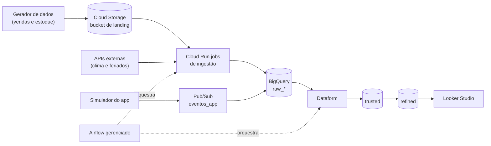

# Colheita

Plataforma de dados da **Rede Sabiá** (rede fictícia de 40 supermercados com app de delivery), construída na Google Cloud como projeto de estudo que simula o dia a dia de um time de engenharia de dados.

> Status: em construção. O andamento está no board **Colheita** do GitHub Projects (cards `COL-001` a `COL-032`).

## Visão geral

O que a plataforma entrega:

| Produto de dados | Para quem | Atualização |
|---|---|---|
| Painel diário de vendas por loja | Gerentes regionais | Diária |
| Indicador de ruptura de estoque | Abastecimento | Diária |
| Base de eventos do app de delivery | Produto | Quase em tempo real |

Ambientes:

| Ambiente | Projeto GCP | Uso |
|---|---|---|
| dev | `colheita-dev-po14` | Desenvolvimento e testes |
| prd | `colheita-prd-po14` | Dados usados pelo negócio |

Todos os recursos ficam na região **`southamerica-east1`** (São Paulo).

### Custos

| Item | Valor |
|---|---|
| Budget mensal | _preencher (COL-001)_ |
| Fim do crédito gratuito | _preencher (COL-001)_ |
| Custo diário do Airflow gerenciado | _preencher (COL-022)_ |

## Arquitetura



### Camadas no BigQuery

| Dataset | O que guarda |
|---|---|
| `raw_estoque`, `raw_vendas`, `raw_externo`, `raw_app` | Dado **como chegou**, sem tratamento |
| `trusted` | Dado limpo, tipado e sem duplicidade |
| `refined` | Fatos, dimensões e agregados prontos para o painel |

### Stack

Cloud Storage, BigQuery, Cloud Run jobs (Python 3.12), Pub/Sub, Dataform, Managed Service for Apache Airflow, Secret Manager, Terraform, GitHub e Cloud Build.

### Estrutura do repositório

```text
colheita/
├── .github/        # templates de PR e de issues
├── airflow/        # DAGs e testes do Airflow
├── cloudbuild/     # pipelines de CI/CD
├── dataform/       # transformações SQL (trusted e refined)
├── docs/           # documentação, ADRs, runbook
├── ingestao/       # código Python dos Cloud Run jobs e simuladores
├── scripts/        # scripts de apoio (ex.: criar issues)
└── terraform/      # infraestrutura como código
    ├── bootstrap/  # criação única do bucket de state
    ├── envs/       # dev e prd
    └── modules/    # módulos reutilizáveis
```

## Como rodar

### Pré-requisitos

Siga o checklist de ambiente (Windows 10 + WSL2) do card **COL-003**. Você vai precisar de: Git, Python 3.12, Google Cloud CLI, Terraform, Docker Desktop e GitHub CLI.

### 1. Clonar o repositório

```bash
gh repo clone <seu-usuario>/colheita
cd colheita
```

### 2. Autenticar no Google Cloud (sem chave JSON)

```bash
# Login da sua conta pessoal
gcloud auth login

# Credencial local para bibliotecas e Terraform (ADC)
gcloud auth application-default login

# Selecionar o ambiente de dev
gcloud config configurations activate colheita-dev
```

Para agir como uma service account, use **impersonation** (sua conta "pega emprestada" a identidade da SA, sem baixar chave):

```bash
gcloud config set auth/impersonate_service_account \
  sa-ingestao@colheita-dev-po14.iam.gserviceaccount.com
```

### 3. Python (ingestão)

```bash
python3.12 -m venv .venv
source .venv/bin/activate
pip install -r ingestao/requirements-dev.txt   # disponível a partir do COL-010
pytest
```

### 4. Terraform (infraestrutura)

```bash
cd terraform/envs/dev
terraform init
terraform plan      # só mostra o que mudaria, não cria nada
```

> `terraform apply` em dev e prd roda pelo Cloud Build depois do merge (COL-009). Não rode `apply` em **prd** pela sua máquina.

### 5. Airflow local

Instruções no card **COL-020** (Docker Compose).

## Convenções

| Tema | Regra |
|---|---|
| Nomes | Português, sem acento, `snake_case` (ex.: `vendas_diarias`, `sa-ingestao`) |
| Service accounts | Uma por função: `sa-ingestao`, `sa-dataform`, `sa-airflow`, `sa-cloudbuild` |
| Autenticação | ADC e impersonation. **Nunca** chave JSON de service account |
| Labels | `time=dados`, `projeto=colheita`, `ambiente=dev\|prd` em todo recurso |
| Região | `southamerica-east1` em todos os recursos |
| Código | Idempotente, parametrizado por `data_ref`, logs em JSON, testes com `pytest`, comentários curtos em português |
| Branches | `tipo/COL-000-descricao`, curtas, a partir da `main` |
| Commits | [Conventional Commits](https://www.conventionalcommits.org/pt-br/) |

Exemplos de mensagens de commit:

```text
feat(ingestao): carregar estoque diario na raw_estoque
fix(dataform): remover vendas duplicadas na trusted
chore: atualizar versao do provider google no terraform
```

O fluxo completo (branches, commits, PR e revisão) está no [CONTRIBUTING.md](CONTRIBUTING.md).
